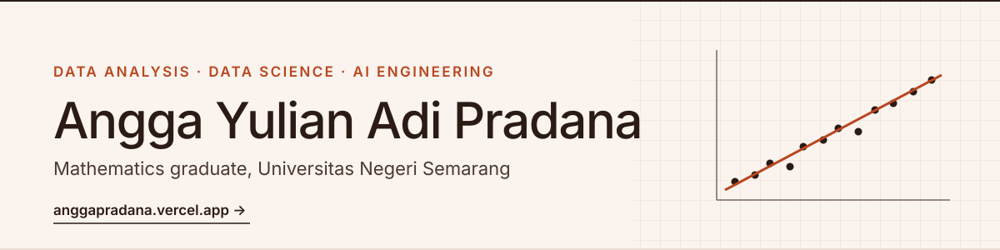
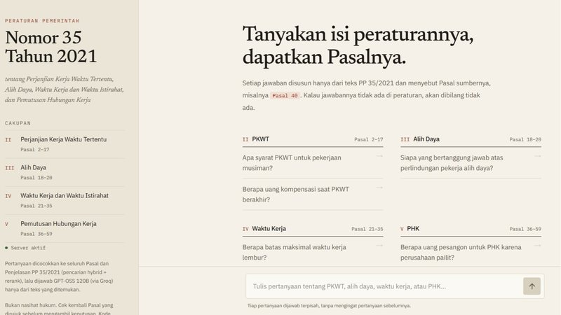
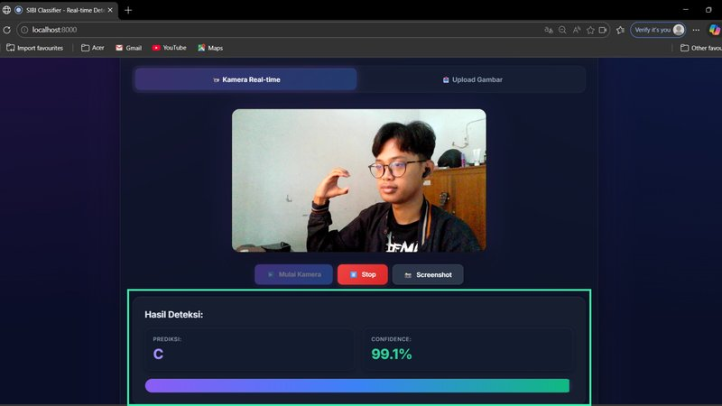
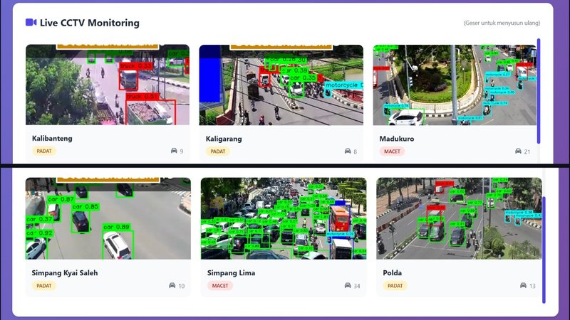
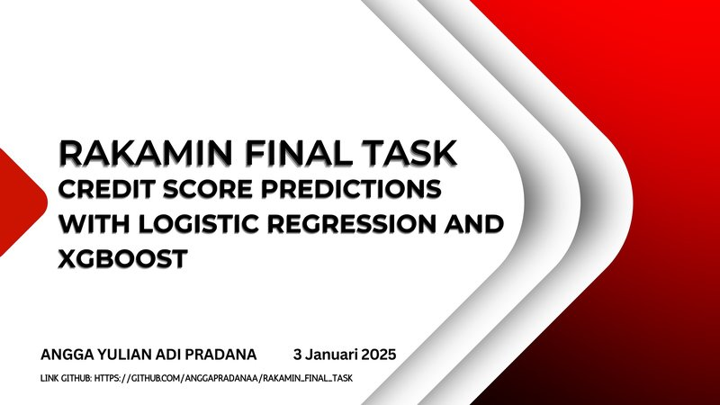
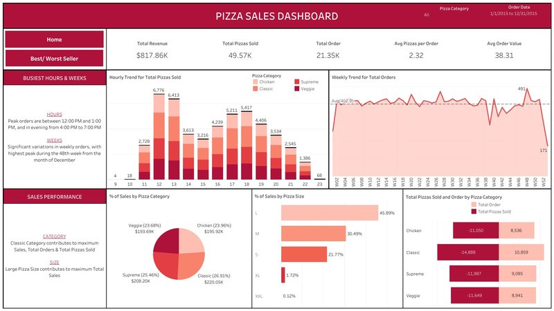
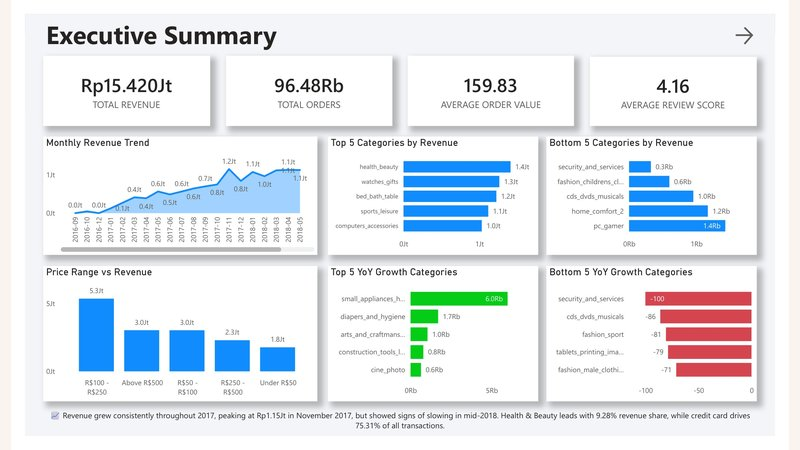

  
  
  

Hi, I'm Angga 👋 I studied mathematics at Universitas Negeri Semarang and now work across **data analysis, data science, and AI engineering**. I've analyzed official statistics at BPS, built credit scoring and lead scoring models, and shipped a RAG chatbot and a sign language recognition app that run in the browser. Most recently I spent six months as a Curriculum Developer Intern at Dicoding, teaching AI and data to bootcamp cohorts and live audiences of up to 1.2k viewers.

## 🚀 Selected projects

<table>
  <tr>
    <td width="50%" valign="top">
      
       <b>AI ENGINEERING · LLM · RAG</b>
      <h3>Indonesian labor regulation assistant</h3>
      A chatbot that answers questions about PP 35/2021 and cites the article behind every answer. Hybrid dense and sparse retrieval, cross-encoder reranking, and an anti-hallucination prompt.
        <a href="https://frontend-iota-nine-14.vercel.app">Live demo ↗</a> · <a href="https://github.com/anggapradanaa/indonesia-labor-rag">Code</a>
    </td>
    <td width="50%" valign="top">
      
       <b>AI ENGINEERING · DEEP LEARNING</b>
      <h3>SIBI sign language recognition</h3>
      Reads SIBI hand signs in real time from a webcam. ResNet50 with transfer learning at 99.33% test accuracy, converted to TensorFlow.js so it runs entirely in the browser.
        <a href="https://sibi-sign-language-recognition.vercel.app">Live demo ↗</a> · <a href="https://github.com/anggapradanaa/sibi-sign-language-recognition">Code</a>
    </td>
  </tr>
  <tr>
    <td width="50%" valign="top">
      
       <b>DATA SCIENCE · COMPUTER VISION</b>
      <h3>FLO: traffic flow decomposition</h3>
      YOLOv8 vehicle detection on live CCTV feeds in Semarang, junction status, and route recommendations with A* and Dijkstra. 2nd and 3rd place at two national competitions.
        <a href="https://github.com/anggapradanaa/flo_pkm_amli_2025">A* code</a> · <a href="https://github.com/anggapradanaa/FLO-Project-Using-YOLOv8-with-Djikstra">Dijkstra code</a>
    </td>
    <td width="50%" valign="top">
      
       <b>DATA SCIENCE · CREDIT RISK</b>
      <h3>Credit default scoring</h3>
      Home Credit customer data, class imbalance handled with SMOTEENN, Logistic Regression against XGBoost (ROC-AUC 0.70 vs 0.67), and lending recommendations.
        <a href="https://github.com/anggapradanaa/Data-Scientist-Intern-Home-Credit-Indonesia-Project-Based-Internship-via-Rakamin-Academy">Code</a>
    </td>
  </tr>
  <tr>
    <td width="50%" valign="top">
      
       <b>DATA ANALYSIS · SQL · TABLEAU</b>
      <h3>Pizza sales dashboard</h3>
      SQL exploration and a two-page Tableau dashboard on a year of orders: $817.86K revenue from 21.35K orders, peak hours, busiest weeks, and best and worst sellers.
        <a href="https://public.tableau.com/app/profile/angga.yulian.adi.pradana/viz/PizzaSalesDashboard_17059985450830/Home">Dashboard ↗</a> · <a href="https://github.com/anggapradanaa/Pizza-Sales-Dashboard-using-SQL-and-Tableau">Code</a>
    </td>
    <td width="50%" valign="top">
      
       <b>DATA ANALYSIS · POWER BI</b>
      <h3>Olist e-commerce dashboard</h3>
      A Power BI dashboard and insight report on 96,480 orders: revenue trends, category growth, price ranges, and payment methods.
        <a href="https://github.com/anggapradanaa/olist-ecommerce-analytics-powerbi">Report</a>
    </td>
  </tr>
</table>

## 💼 Experience

| When | Role | Highlights |
|---|---|---|
| May – Oct 2026 | **Curriculum Developer Intern** Dicoding Indonesia | Taught 2 bootcamp classes (rated 4.79 and 4.87/5) and 2 DevCoach live sessions (1.8k+ live viewers), built 6 training decks and 4 microlearning classes, resolved 140 module issues |
| Aug – Dec 2025 | **Machine Learning Trainee** ASAH, Dicoding × Accenture | 930+ hours of training, CatBoost lead scoring with SHAP as capstone (94/100) |
| Apr – Jul 2025 | **Statistical Technical Team Intern** BPS Kota Tegal | Visualizations for official statistics, K-Means clustering of sub-districts by family welfare |
| Jan – Feb 2025 | **Data Scientist Intern** Home Credit Indonesia via Rakamin | Credit default scoring with Logistic Regression and XGBoost |

## 🎤 Teaching & speaking

- **DevCoach #238** · Mengenal RAG: Dari Konsep ke Implementasi Pertamamu · 644 live viewers, rated 4.64/5 · [Watch](https://www.youtube.com/live/-1_IJOmJu1E)
- **DevCoach #244** · Kenalan dengan Jev: Model AI yang Nggak Bisa Ngobrol · 1.2k live viewers, rated 4.66/5 · [Watch](https://www.youtube.com/live/B9TFa-95Ato)
- **Article** · [Pentingnya Chunking Strategy dalam RAG](https://www.dicoding.com/blog/pentingnya-chunking-strategy-dalam-rag/) on the Dicoding Blog

## 🛠 Toolkit

**Data analysis** 

**Data science & ML** 

**AI engineering** 

---

More on my portfolio: <a href="https://anggapradana.vercel.app">anggapradana.vercel.app</a> · Mathematics, Universitas Negeri Semarang (GPA 3.85/4.00)
